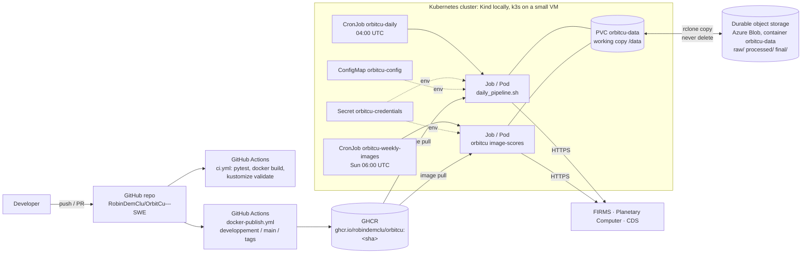
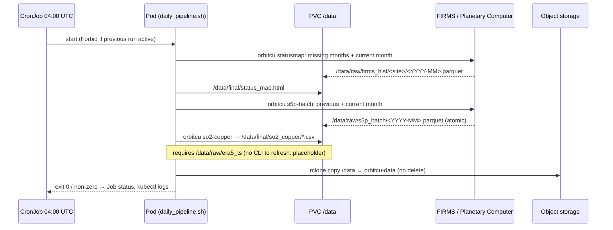

# OrbitCu — Infrastructure Architecture

> **Status: design (Phase 2).** This document describes the target
> infrastructure. The application code it builds on **exists**. Docker,
> Kubernetes, CI/CD and object storage are **planned and not implemented**.
> See [IMPLEMENTATION_STATUS.md](IMPLEMENTATION_STATUS.md) for the exact state of each item and
> [INFRASTRUCTURE_AUDIT.md](INFRASTRUCTURE_AUDIT.md) for the facts this design is based on.

## 1. Goals and constraints

| Goal | Consequence for the design |
|---|---|
| Run the existing `orbitcu` CLI every day without a human | Container image + Kubernetes CronJob |
| Never lose downloaded satellite data | Durable object storage outside the cluster; the cluster disk is a working copy only |
| Reproducible | Image built by CI from a tagged commit, with pinned dependencies |
| Cost ≈ \$0 for a student team | Local Kind cluster for development; one small VM (k3s) or a team machine for the daily runs; Azure for Students credit for storage |
| Understandable by students | Plain YAML + Kustomize, no Helm, no Argo at first |
| Do not change the science | The infrastructure only calls existing CLI commands with path arguments |

## 2. What exists today

```
Team laptop (Windows 11 / Linux)
  └─ pip install -e ".[dev,era5,s5p,emissions]"
  └─ orbitcu <command> ...           (started by hand)
        ├─ reads  data/registry/*.csv, data/reference/*.csv   (in Git)
        ├─ calls  NASA FIRMS, Planetary Computer, Copernicus CDS
        └─ writes output/ and cache/  (local disk, ignored by Git)
```

Tests run by hand with `pytest`. No automation, no container, no shared storage.

## 3. Target architecture



### Components

| Component | Role | Status |
|---|---|---|
| GitHub repository | Code, manifests, docs | exists |
| GitHub Actions CI | Tests, image build check, manifest validation | planned ([CI_CD.md](CI_CD.md)) |
| GHCR | Stores the `orbitcu` image, tagged with the commit SHA | planned |
| Docker image | Python 3.12-slim, editable install of the repo in `/app`, non-root | planned ([DOCKER.md](DOCKER.md)) |
| Kubernetes CronJobs | Daily pipeline + weekly image scores | planned ([KUBERNETES.md](KUBERNETES.md)) |
| PVC `orbitcu-data` | Working copy of the data tree, kept between runs | planned |
| Object storage | Durable copy of RAW / PROCESSED / FINAL | planned ([STORAGE.md](STORAGE.md)) |
| Kubernetes Secret | `FIRMS_MAP_KEY`, `CDSAPI_KEY`, storage credentials | planned ([SECURITY.md](SECURITY.md)) |

## 4. Key decisions

### D1. CronJobs, not Argo Workflows (for now)

The daily work is short and almost linear (section 5). The resumable commands
already handle partial failures by skipping and retrying on the next run.
One CronJob running a small shell script gives ordering, no overlap
(`concurrencyPolicy: Forbid`), retries (`backoffLimit`) and logs
(`kubectl logs`), with nothing to install in the cluster.

Argo Workflows would add per-step retries, a DAG view and artefact passing,
but it needs a controller, CRDs, RBAC and a UI to operate. **We revisit
Argo** when there are more than about five dependent steps (after the
activity-index and production entry points exist), or when the steps need
different resources. The job boundaries already follow the report's "one job
per task" design, so the move would be mechanical.

### D2. Two schedules, not one per source

- `orbitcu-daily`: `statusmap` (VIIRS), then `s5p-batch` (SO2), then
  `so2-copper`. They run in sequence in one pod. Sequential order keeps one
  FIRMS client at a time (the quota is per key) and makes sure `so2-copper`
  sees the new S5P month.
- `orbitcu-weekly-images`: `image-scores` for the current year. That command
  rescans the whole current year on every run (audit finding R7), so daily
  runs would mostly redo the same work.

The per-site commands `firms`, `optical`, `s5p` and `era5` overwrite their
output with the requested window (audit finding A-6). They are kept for
**manual backfills** (a Kubernetes Job created from a template) and are
**not scheduled**.

### D3. Durable storage = object storage; PVC = working copy

The code reads and writes local paths and checks `path.exists()` to skip
finished work. That check is what makes it incremental. Mounting object
storage as a filesystem is possible (Azure Blob CSI / blobfuse2), but it is
not available on Kind and its semantics differ from a local disk. The chosen
design is:

1. A PVC holds the full data tree, so the code runs unchanged and stays incremental.
2. After each successful run, `rclone copy` pushes new and changed files to
   object storage. `copy` **never deletes** at the destination.
3. A new or rebuilt cluster first runs a restore Job (`rclone copy` from
   object storage to the PVC).

**The object store is the source of truth. The PVC can be lost.** Details,
retention, costs and alternatives are in [STORAGE.md](STORAGE.md).

### D4. Azure Blob Storage first, S3-compatible as fallback

The report states that optional cloud use is covered by **Azure for
Students**. Azure Blob (StorageV2, LRS, Hot or Cool tier) gives versioning
and soft delete, which protect against accidental overwrites. `rclone`
speaks both Azure Blob and S3, so moving to an S3-compatible service
(Cloudflare R2, Backblaze B2, or a self-hosted MinIO) only changes the
rclone remote configuration.

### D5. Runtime cluster: Kind for development, k3s on one small VM for daily runs

Managed Kubernetes (AKS) is not required. A single-node k3s on a small VM,
or an always-on team machine, runs the same manifests. Kind is used to
validate them locally and in CI (dry run). Costs are discussed in
[STORAGE.md §8](STORAGE.md#8-cost-estimate).

### D6. Image tags = commit SHA

Kubernetes manifests reference `ghcr.io/robindemclu/orbitcu:sha-<short-sha>`,
never only `:latest`. A rollback means changing one line (the Kustomize
`images:` entry). See [CI_CD.md](CI_CD.md).

## 5. Daily data flow (planned)



## 6. Point-in-time (no look-ahead) rules

The infrastructure does not change these rules. Every record keeps
`acquired_at` and `available_at` as written by `ingest.pit`. The storage
layer copies files byte for byte. The schedule (04:00 UTC) only decides
**when** data are fetched, not how `available_at` is computed. Re-running a
day, or restoring from backup, gives the same files, because the commands
recompute unfinished months from the providers.

## 7. Portability

| Concern | Local (Kind) | Small VM (k3s) | Managed (AKS / other) |
|---|---|---|---|
| Image | `kind load docker-image` or GHCR | GHCR | GHCR |
| PVC storage class | `standard` (local-path) | `local-path` | cloud disk (e.g. `managed-csi`) |
| Durable storage | optional (MinIO or none) | Azure Blob via rclone | Azure Blob via rclone, or Blob CSI mount |
| Secrets | `kubectl create secret` | `kubectl create secret` | Key Vault + workload identity (optional) |

Only the Kustomize overlay changes between environments. See [KUBERNETES.md](KUBERNETES.md).
