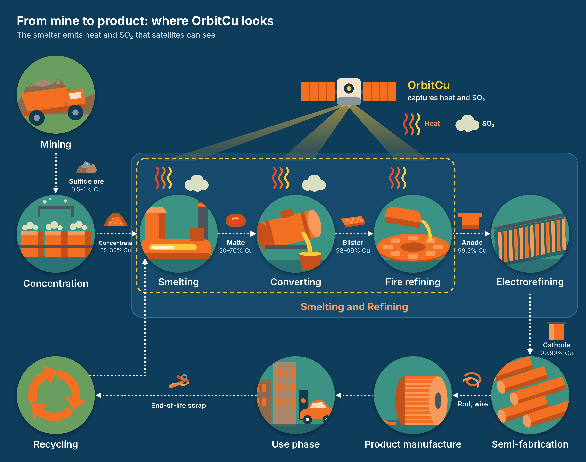

# OrbitCu: Technical Report

Team CoPPernicus (CSE 406). Living document, last exported 20 November 2026.

## 1. Introduction

OrbitCu measures, every day, whether the 30 largest copper smelters in the world are operating, using only free satellite data. It publishes capacity-weighted activity indices and evaluates their value for trading copper futures.

**Motivation.** Copper is central to power grids, electric vehicles and renewable energy. A small number of large smelters accounts for most of the world's capacity. When one stops (maintenance, accident, power shortage), refined supply tightens and prices can move. Official statistics, however, are published monthly, several weeks after the fact.

**Physical signal.** Furnaces and converters emit intense heat visible in shortwave infrared (SWIR). Smelting sulfide ores releases sulfur dioxide (SO₂), measurable from space. Free missions observe the whole planet every few days.

**Client needs** (a commodity trading or research desk):

| Need | Resulting requirement |
| --- | --- |
| Timeliness | An estimate days or weeks before official figures |
| Transparency | Every number traceable to raw observations |
| Point-in-time history | The availability date of every piece of information, for look-ahead-free backtests |
| Actionability | Production nowcasts and an honest evaluation on futures |
| Affordability | Free data, open-source software |

**Contribution.** A reproducible Kubernetes pipeline in nine stages: smelter registry, satellite ingestion, thermal detection, SO₂ estimation, multi-sensor fusion (state-space model), activity indices, validation and nowcasting, point-in-time backtesting, web dashboard. Out of scope: real-money trading, commercial high-resolution imagery, mine monitoring.

## 2. Related Work

Commercial services show that the signal has value; research provides the technical building blocks. No open system combines them into a reproducible index evaluated for trading.

| Work | Contribution | Limitation for us |
| --- | --- | --- |
| SAVANT, Earth-i \[1\]–\[3\] | Satellite monitoring of copper smelters (\~70% of world capacity), launched in 2019 with Marex | Closed and paid ($10k–$250k per year) |
| SMM \[4\] | Relays satellite estimates of inactive capacity (11.8% in Aug. 2025) | Headline figures only |
| TransitionZero, Climate TRACE \[5\] | Infrared hotspots to estimate heavy-industry activity | Not copper-specific |
| Massimetti et al. \[6\] | Sentinel-2 SWIR hotspot detection | Designed for volcanoes |
| Fioletov et al. \[7\] | Catalogue of 491 large SO₂ sources, including 53 smelters | Annual emissions, not daily activity |
| ddeq \[8\] | Open-source point-source emission estimation (flux divergence) | Demonstrated on NO₂, not SO₂ |
| Finch and Palmer \[9\] | U-Net segmentation of SO₂ plumes in TROPOMI | Detects plumes, not activity; weaker over China |

### 2.1 Background: where to observe copper

OrbitCu observes the smelter (smelting, converting and fire refining in the figure below), because it is the only stage of the copper chain with a signature visible from space. Smelting and converting run at furnace temperatures and burn the sulfur in the concentrate, which produces both intense shortwave-infrared heat and SO₂.

**Copper life cycle in brief.** Sulfide ore (0.5–1% Cu) is mined and concentrated by flotation to 25–35% Cu. The smelter melts the concentrate into matte (50–70% Cu), converts it to blister (98–99%) and fire-refines it into anodes (99.5%). Electrorefining then produces cathode (99.99%), the traded commodity, which is semi-fabricated into rod and wire, built into products and, at end of life, partly returned as scrap to smelters and refineries.

The other stages are not observable or are out of scope. Mines and concentrators are out of scope. Electrorefineries use low-temperature electrolysis and emit neither heat nor SO₂. Refined supply that bypasses smelters (SX-EW cathode from leached oxide ores, and scrap) is invisible to OrbitCu, which limits how much of refined output the indices can explain. For the same reason, registry capacities should be expressed as blister or anode copper, the output of the observed stages.

## 3. Data

### 3.1 Satellite data sources and access platforms

OrbitCu uses five free datasets reached through three access platforms. Sources are grouped by platform because access keys, quotas and failure modes are set per platform, not per satellite.

| Platform | Datasets (sensor) | Signal for OrbitCu | Resolution and timeliness | Main limits |
| --- | --- | --- | --- | --- |
| Microsoft Planetary Computer, STAC API \[10\], \[16\] | Sentinel-2 L2A (MSI); Landsat Collection 2 L2 (OLI/TIRS); Sentinel-5P L2 (TROPOMI) | Furnace heat in SWIR (S2 B11 1.61 µm, B12 2.19 µm; Landsat SWIR 1.6/2.2 µm); SO₂ total column (S5P) | S2: 20 m SWIR, about 5-day revisit, archive since 2015. Landsat: 30 m SWIR, 100 m surface temperature. S5P: 5.5 × 3.5 km pixels, daily, since April 2018 | Daytime optical passes masked by cloud; files sit on Azure Blob Storage behind short-lived SAS tokens (about 1 h); SO₂ from smaller smelters close to the detection limit |
| NASA FIRMS (LANCE) \[17\] | VIIRS 375 m active fire (S-NPP, NOAA-20, NOAA-21); MODIS | Night-time thermal anomalies at each site | Global near-real-time detections within 3 hours of overpass; separate standard-processing archive | Free MAP\_KEY limited to 5,000 transactions per 10 minutes; at most 5 days per area request; product tuned for fires, 375 m footprint, no detection under cloud |
| Copernicus Climate Data Store (C3S, ECMWF) \[18\] | ERA5 hourly reanalysis on single levels | Wind fields that turn SO₂ columns into emission rates | 0.25° grid, hourly, since 1940; daily update with about 5 days latency (ERA5T), final release 2–3 months later | Licence must be accepted per account; requests are queued; ERA5T values can be revised, so the availability date must be stored for point-in-time use |

**Access status (4 November 2026).** From the project's cloud environment, the Planetary Computer STAC catalogue and its pixel cut-out API (Sentinel-2, Landsat), the FIRMS key and the CDS key all work. Two downloads remain blocked by the network allow-list: Sentinel-5P files, which the catalogue serves from sentinel5euwest.blob.core.windows.net, and CDS result files, served from an ECMWF object store. The ERA5 licence was accepted on 4 November and a test request is queued. Backfill covers 2018 to present, then incremental ingestion as new acquisitions are published.

### 3.2 Smelter registry (stage 1, draft)

The draft registry lists 29 primary copper smelters with about 11.7 Mt/yr of combined capacity (28 sites with a copper figure); slot 30 is deliberately left open. Each site was checked against documents published by its operator (annual and interim reports, securities filings, results presentations, company web pages). 8 sites have both a dated 2025-2026 operator confirmation of activity and an operator capacity figure (A), 11 have a dated operator confirmation of activity but no site capacity from the operator (B), and 10 have no dated operator confirmation (C). The quotes, dates and links for each site are in smelter\_registry\_draft.csv.

**Selection rules.** Only smelters are included, because refineries (electrolysis) emit neither furnace heat nor SO₂. A site is kept if no source reports it closed or suspended as of November 2026; sites restarting in 2026 are kept with a flag. Sites are ranked by nameplate capacity in kt of copper per year.

**Caveat on capacity.** No free, current, plant-level capacity table exists: the ICSG directory, Statista and Wood Mackenzie are paywalled. Figures therefore mix years (2015 to 2026) and stages (blister, anode or cathode), and sources can disagree widely (Onahama: 354 kt in 2020 vs 230 kt in 2026). Capacities must be harmonised to blister or anode copper before computing indices.

**Operator check levels.** *A*: a dated 2025-2026 operator document confirms that the site is operating, restarting or temporarily halted, and the operator publishes a capacity figure for the site. *B*: a dated 2025-2026 operator document confirms activity, by naming the site or reporting its output, but the capacity comes from a secondary source. *C*: no dated 2025-2026 operator document confirming activity was found, because the operator does not publish site data, its website refuses automated access (Xiangguang, Dongying Fangyuan, Daye, NICICO), or the document could not be read. C sites need satellite confirmation first.

| # | Smelter | Country | Operator | Capacity (kt Cu/yr) | Check | Operator evidence of activity | Operator capacity evidence |
| --- | --- | --- | --- | --- | --- | --- | --- |
| 1 | Guixi | China | Jiangxi Copper | 900 (copper (2015, secondary)) | B | ["Five smelters under production: Guixi Smelter, ..." (FY2025 results, p.21) (2026-03-27)](https://www1.hkexnews.hk/listedco/listconews/sehk/2026/0327/2026032700065.pdf) | [No site figure; operator: "single-unit copper smelter of the largest scale in the world"; group cathode capacity >2.0 Mt/yr](https://www1.hkexnews.hk/listedco/listconews/sehk/2026/0327/2026032700065.pdf) |
| 2 | Onsan | South Korea | LS MnM | 650 (copper output 2024 (secondary; cut to \~550 in 2025)) | C | [Operator website lists "Copper Smelter and Refinery in Korea" (undated page)](https://www.lsmnm.com/en/main) | Not published on operator site; 2025 sustainability report and DART filing not readable |
| 3 | Kamoa-Kakula | DR Congo | Ivanhoe Mines / Zijin | 500 (anode, design capacity (operator)) | A | [Smelter produced 62,072 t anode in Q2 2026; running at 60% of design (2026-07-08)](https://www.ivanhoemines.com/wp-content/uploads/20260708-Q2-2026-Production-Results-ABF.pdf) | ["500,000 tonnes-per-annum copper smelter"; full capacity expected 2028](https://www.ivanhoemines.com/wp-content/uploads/20260708-Q2-2026-Production-Results-ABF.pdf) |
| 4 | Kutch Copper (Mundra) | India | Adani Enterprises | 500 (copper, capacity (operator)) | A | ["During Q2, Copper plant operated at \~64% of annual capacity" (Q2 FY27); H1 FY27 production 145.6 kt (2026-10-28)](https://www.adanienterprises.com/-/media/Project/Enterprises/Investors/Investor-Downloads/Results-Presentations/Q2-FY-27.pdf) | ["having capacity of 500 KTPA"](https://www.adanienterprises.com/-/media/Project/Enterprises/Investors/Investor-Downloads/Results-Presentations/Q2-FY-27.pdf) |
| 5 | Birla Copper (Dahej) | India | Hindalco | 421 (copper, current capacity (operator; 721 after expansion)) | A | ["operates India's largest single-location custom copper smelter at Dahej"; FY26 cathode 420 kt (company) (FY2025-26)](https://www.hindalco.com/iar-summary-online-report-2026/pdf/Statutory%20Reports.pdf) | ["brownfield smelter expansion at Dahej (from 421 KTPA to 721 KTPA)"](https://www.hindalco.com/iar-summary-online-report-2026/pdf/Statutory%20Reports.pdf) |
| 6 | Jinguan (Tongling) | China | Tongling Nonferrous | 480 (blister (2023, secondary)) | B | [Jinguan branch named in the 2025 half-year report (environmental disclosure list); company cathode capacity >1.7 Mt (2025-08)](https://pdf.dfcfw.com/pdf/H2_AN202508171729212469_1.pdf) | [No site figure from operator; broker (Guosen, Apr 2026) table: 70 万t smelting+refining](https://pdf.dfcfw.com/pdf/H3_AP202604221821432622_1.pdf) |
| 7 | Glogow I + II | Poland | KGHM | 475 (cathode (operator)) | A | [2025 copper output lower "due to planned maintenance at the Glogow II Copper Smelter and Refinery"; electrolytic copper 571 kt (2026-03-25)](https://media.kghm.com/en/news-and-press-releases/higher-net-profit-costs-control-and-ambitious-plans-for-the-future-kghm-summarises-2025) | [Operator site page gives Glogow capacity (cathode)](https://kghm.com/en/node/1373) |
| 8 | Chuquicamata | Chile | Codelco | 450 (copper (2015, secondary; SMM 2023 says 300)) | C | [Not found: Codelco operations and results pages (2026) name only the Ventanas smelter and the Chuquicamata concentrator (2026)](https://codelco.com/operaciones) | Not found |
| 9 | Jinchuan Fangchenggang | China | Jinchuan Group | 450 (copper (2020, secondary)) | C | [Not found on operator site (group news only) (2026-11-03)](https://www.jnmc.com/) | [Not found; group copper capacity 1.1 Mt (JCI presentation 2023)](https://minedocs.com/24/Jinchuan_Group-CP-2023.pdf) |
| 10 | Hamburg | Germany | Aurubis | 450 (copper (2020, secondary); operator gives concentrate throughput) | A | [Concentrate throughput 1,071 kt in FY2024/25 (2025-12)](https://www.aurubis.com/en/dam/jcr:d9520ffc-c965-47af-8fdc-e2901576d08d/Aurubis_Company%20Release_FY%202024_25.pdf) | [Throughput 1,071 kt concentrate FY2024/25 (no copper nameplate)](https://www.aurubis.com/en/dam/jcr:d9520ffc-c965-47af-8fdc-e2901576d08d/Aurubis_Company%20Release_FY%202024_25.pdf) |
| 11 | Toyo (Niihama) | Japan | Sumitomo Metal Mining | 450 (copper, single line (operator, undated)) | C | [Operator page: "the Toyo Smelter & Refinery continues to smelt copper" (undated); latest securities report covers to Mar 2024 (undated)](https://www.smm.co.jp/en/corp_info/location/domestic/toyo/) | ["production capacity of 450,000 tonnes on a single line"](https://www.smm.co.jp/en/business/refining/) |
| 12 | Saganoseki | Japan | JX Advanced Metals | 450 (copper (2020, secondary)) | B | [Listed among domestic manufacturing sites (Integrated Report 2025) (2025-10)](https://wwwcdn.furuchi.co.jp/sustainability/pdf/report2025_j_interactive.pdf) | [Not found; JX plans to reduce smelting capacity (secondary, Sep 2025)](https://www.mining-technology.com/news/jx-advanced-metals-cut-copper-production-smelting-capacity/) |
| 13 | Chifeng Yunjin | China | Yunnan Copper (45%) | 400 (copper (2020, secondary)) | B | [2025 cathode output 433.6 kt (Yunnan Copper AR 2025, p.12) (2026-03-27)](https://static.cninfo.com.cn/finalpage/2026-03-27/1225037769.PDF) | [No nameplate; output 433.6 kt cathode 2025](https://static.cninfo.com.cn/finalpage/2026-03-27/1225037769.PDF) |
| 14 | Southeast Copper (Ningde) | China | Yunnan Copper (60%) / Chinalco | 400 (copper (2020, secondary)) | B | [2025 cathode output 486.0 kt (Yunnan Copper AR 2025, p.12) (2026-03-27)](https://static.cninfo.com.cn/finalpage/2026-03-27/1225037769.PDF) | [No nameplate; output 486.0 kt cathode 2025](https://static.cninfo.com.cn/finalpage/2026-03-27/1225037769.PDF) |
| 15 | Xiangguang (Yanggu) | China | Xiangguang Copper (private) | 400 (copper (2020, secondary)) | C | Not found (operator website refuses automated access) | Not found |
| 16 | Dongying Fangyuan | China | Dongying Fangyuan (private) | 400 (blister (2023, secondary)) | C | Not found (operator website refuses automated access) | Not found |
| 17 | Caletones (El Teniente) | Chile | Codelco | 250 (fine copper, operator target for 2028 (current output lower)) | B | [103rd anniversary article; smelter operating, capacity restitution under way (2025-05-05)](https://codelco.com/fundicion-caletones-celebro-103-anos-con-desafiantes-proyectos-a-futuro-0) | [Target: smelt 1.5 Mt concentrate and \~250 kt fine copper by 2028 (page meta says 350 kt)](https://codelco.com/fundicion-caletones-celebro-103-anos-con-desafiantes-proyectos-a-futuro-0) |
| 18 | Norilsk Copper Plant | Russia | Nornickel | 400 (copper (2020, secondary)) | C | [Annual Report 2024 describes the Copper Plant producing cathode; no 2025-26 operator document read (2025 (AR 2024))](https://ar2024.nornickel.com/pdf/ar/en/business-overview_operational-performance.pdf) | [Not found; group copper output 432.5 kt (2024)](https://ar2024.nornickel.com/pdf/ar/en/business-overview_operational-performance.pdf) |
| 19 | Pirdop | Bulgaria | Aurubis | 360 (copper (2020, secondary); operator gives concentrate throughput) | A | [Concentrate throughput 1,109 kt in FY2024/25 (2025-12)](https://www.aurubis.com/en/dam/jcr:d9520ffc-c965-47af-8fdc-e2901576d08d/Aurubis_Company%20Release_FY%202024_25.pdf) | [Throughput 1,109 kt concentrate FY2024/25](https://www.aurubis.com/en/dam/jcr:d9520ffc-c965-47af-8fdc-e2901576d08d/Aurubis_Company%20Release_FY%202024_25.pdf) |
| 20 | Ilo | Peru | Southern Copper | 360 (copper (2020, secondary)) | B | ["We also operate a smelter and refinery ... in the coastal city of Ilo, Peru" (10-K FY2025) (2026-02-27)](https://www.sec.gov/Archives/edgar/data/1001838/000110465926021492/scco-20251231x10k.htm) | [1.1 Mt concentrate/yr (2003 modernisation, operator history page); 10-K Item 2 not readable](https://southerncoppercorp.com/eng/?p=54) |
| 21 | Jinchuan HQ (Jinchang) | China | Jinchuan Group | 350 (blister (2023, secondary)) | C | [Not found on operator site (group news only) (2026-11-03)](https://www.jnmc.com/) | Not found |
| 22 | Heding (Fuyang) | China | Jiangxi Copper JV | 350 (copper (2020, secondary; SMM 2023: 2 x 150)) | B | [Listed among "Five smelters under production" (FY2025 results, p.21) (2026-03-27)](https://www1.hkexnews.hk/listedco/listconews/sehk/2026/0327/2026032700065.pdf) | [No site figure](https://www1.hkexnews.hk/listedco/listconews/sehk/2026/0327/2026032700065.pdf) |
| 23 | Jinlong (Tongling) | China | Tongling Nonferrous (61.4%) | 350 (copper (2020, secondary; SMM 2023: 320)) | B | [Subsidiary producing cathode, sulfuric acid, silver; H1 2025 revenue RMB 19.2 bn (2025-08)](https://pdf.dfcfw.com/pdf/H2_AN202508171729212469_1.pdf) | [No site figure from operator; broker (Guosen, Apr 2026): 46 万t](https://pdf.dfcfw.com/pdf/H3_AP202604221821432622_1.pdf) |
| 24 | Sarcheshmeh | Iran | NICICO | 350 (copper (2020, secondary)) | C | [Not found (English site refuses automated access; Persian page shows 2020-21 data only)](https://www.nicico.com/) | Not found |
| 25 | PT Smelting (Gresik) | Indonesia | Freeport Indonesia (66%) / Mitsubishi | 342 (cathode (secondary); operator: 1.3 Mt concentrate/yr) | A | [2025 anode output 230.3 kt; restarted late Dec 2025 at reduced rates (10-K FY2025) (2026-02)](https://www.sec.gov/Archives/edgar/data/831259/000083125926000012/fcx-20251231.htm) | ["capacity to process approximately 1.3 million metric tons of copper concentrate per year"](https://www.sec.gov/Archives/edgar/data/831259/000083125926000012/fcx-20251231.htm) |
| 26 | Daye Nonferrous (Huangshi) | China | China Daye Non-Ferrous | 300 (blister (2023, secondary)) | B | [Smelting units produced 275,800 t blister copper in H1 2026 (interim results, p.15) (2026-08-31)](https://www.hkexnews.hk/listedco/listconews/sehk/2026/0831/2026083102821.pdf) | No site figure |
| 27 | Chifeng Jintong | China | Tongling Nonferrous (50%) | 300 (blister (2023, secondary)) | C | Not found in operator documents; broker reports 2025 profit | [Broker (Guosen, Apr 2026): 25 万t; phase 2 (+30 万t) under construction](https://pdf.dfcfw.com/pdf/H3_AP202604221821432622_1.pdf) |
| 28 | Onahama | Japan | Mitsubishi Materials JV | 230 (smelting and refining (2026, secondary)) | B | ["scheduled maintenance shutdowns at the Naoshima Smelter & Refinery and the Onahama Smelting & Refinery" (H2 FY production plan) (2026-10-01)](https://news.mmc.co.jp/corporate/en/newsroom/press/news20261001.html) | Not found |
| 29 | Manyar (PTFI smelter) | Indonesia | Freeport Indonesia | n/a (1.7 Mt concentrate/yr (operator); copper capacity to confirm) | A | [Completed 2025; 2025 anode output 54.1 kt; suspended after Sep 2025 mud rush, restart H2 2026 (10-K FY2025) (2026-02)](https://www.sec.gov/Archives/edgar/data/831259/000083125926000012/fcx-20251231.htm) | ["capacity to process approximately 1.7 million metric tons of copper concentrate per year"](https://www.sec.gov/Archives/edgar/data/831259/000083125926000012/fcx-20251231.htm) |
| 30 | *(open slot)* |  |  |  |  |  |  |

**Corrections from the operator check.** Nadezhda was replaced by the Norilsk Copper Plant: Nornickel's annual report shows that Nadezhda produces nickel converter matte, while copper is smelted at the Copper Plant. "Chifeng Jinfeng" was replaced by Chifeng Yunjin, the Chifeng plant that Yunnan Copper actually reports. Dahej capacity was revised to Hindalco's figure of 421 kt (expansion to 721 kt under way), and Caletones to 250 kt, Codelco's 2028 target, which Codelco says is above current capacity. Codelco's 2026 operations pages do not mention a Chuquicamata smelter, so its status must be checked by satellite. Two sites with operator evidence are candidates for slot 30: Southwest Copper in Kunming (Yunnan Copper; 550 kt/yr cathode design, 565 kt produced in 2025, [annual report](https://static.cninfo.com.cn/finalpage/2026-03-27/1225037769.PDF)) and Jinxin in Tongling (500 kt, commissioned in H2 2025; capacity from a broker report only).

**What the search revealed: the data gap confirms the need.** Identifying the largest smelters was expected to be a lookup task. It was not: no free, current, plant-level table exists, and operator documents leave large holes. Of the 29 sites, 10 have no dated 2025–2026 operator confirmation that they are running, and 20 have no capacity figure published by their operator. A trading desk therefore cannot know from public sources alone whether a fifth of the largest smelters are operating. This is exactly the gap that daily satellite observation fills, and it confirms the client need stated in Section 1.

**Four statuses, four test strategies.** Each site is classified on two questions: is activity confirmed by a dated operator document, and does the operator publish a site capacity? Each combination calls for a different test.

| Activity confirmed? | Operator capacity? | Sites | Test strategy |
| --- | --- | --- | --- |
| Yes | Yes | 8: Kamoa-Kakula, Kutch, Dahej, Glogow, Hamburg, Pirdop, PT Smelting Gresik, Manyar | Calibration and validation set: fit the link between thermal/SO₂ signals and reported output, measure error, compute utilisation |
| Yes | No | 11: Guixi, Jinguan, Saganoseki, Chifeng Yunjin, Southeast, Caletones, Ilo, Heding, Jinlong, Daye, Onahama | Apply the calibrated model to estimate site output; infer effective capacity from the highest sustained signal and compare with secondary figures |
| No | Yes | 1: Toyo | Binary activity test first (persistent heat, SO₂ above background); if active, utilisation = estimated output / known capacity |
| No | No | 9: Onsan, Chuquicamata, Fangchenggang, Xiangguang, Dongying, Norilsk Copper Plant, Jinchang, Sarcheshmeh, Chifeng Jintong | Binary activity test first; if active, estimate both output and capacity from satellite; lowest confidence, flagged in the indices |

The first two rows are the A and B grades; the last two split grade C by whether a capacity figure exists. Chuquicamata, absent from Codelco's 2026 smelter pages, is the first activity test case.

**Excluded large smelters.** Altonorte (Chile) stopped in March 2025 for furnace problems and no restart was found ([SMM](https://news.metal.com/newscontent/103306296/Glencores-Altonorte-Smelter-Extends-Maintenance-Plan-Raising-Copper-Supply-Concerns)). Ventanas (Chile) closed in 2023 and Paipote (Chile) has been idle since February 2024 ([Wikipedia list](https://wiki.krisyotam.com/content/wikipedia_en_all_nopic_2026-03/List_of_copper_smelters_in_Chile)). Potrerillos (Chile) was suspended in 2026 after a structural failure ([CRU](https://www.bcinsight.crugroup.com/2026/07/13/chiles-lawmakers-to-investigate-codelco/)). Guangxi Nanguo and Daye's 400 kt Yangxin Hongsheng line were reported suspended in December 2024 ([Argus](https://www.argusmedia.com/en/news-and-insights/latest-market-news/2642686-viewpoint-cu-smelting-capacity-to-outpace-mining)). Glencore's Mount Isa (Australia) has been under closure review since 2025, outcome unconfirmed ([MINING.COM](https://www.mining.com/glencore-workers-brace-for-layoffs-on-mount-isa-looming-shutdown/)). These shutdowns fall inside the 2018-present backfill and serve as validation events (requirement 5).

**Share of world supply.** The registry holds about 11.7 Mt/yr, around 47% of the 24.7 Mt/yr active capacity counted by SAVANT in 2024 \[13\]; the share is probably lower now, as about 2.8 Mt/yr of new capacity was expected in 2025 \[14\]. Against 2025 world output, 11.7 Mt equals 40% of refined production (29.0 Mt) and 51% of mine production (23.0 Mt) \[15\]. Actual output is lower than capacity: Argus expected utilisation near 70% in 2025 \[14\], which puts these sites at roughly 28% of world refined copper. Refined production also includes SX-EW and scrap refining, which no smelter observation captures.

## 4. Methods and Implementation

The ingestion layer (requirement 2) and the geolocation of the registry were implemented on 4 November 2026 in the Python package `orbitcu` ([pull request #1](https://github.com/RobinDemClu/OrbitCu---SWE/pull/1)). Sentinel-2, Landsat 8/9 and VIIRS run end to end. Sentinel-5P and ERA5 are implemented and unit-tested but could not yet be run (Section 5). The method is documented in `docs/ingestion.md` and the prototype numbers in `docs/prototype_results.md`.

### 4.1 Code layout

| Module | Role |
| --- | --- |
| `sites.py` | Site model: furnace point, 3 × 3 km thermal box, 50 km SO₂ disc, all built in the local UTM zone |
| `geolocate.py` | Persistent-cluster geolocation from VIIRS, Sentinel-2 thermal anomaly index (TAI) hot pixels |
| `activity_check.py` | Monthly VIIRS detection days and an active / intermittent / inactive verdict |
| `ingest/pit.py` | Point-in-time availability rules |
| `ingest/optical.py` | Sentinel-2 L2A and Landsat 8/9 Collection-2 L2 clips |
| `ingest/firms.py` | NASA FIRMS VIIRS client (SP archive, then NRT) |
| `ingest/s5p.py` | Sentinel-5P TROPOMI SO₂ pixels inside the 50 km disc |
| `ingest/era5.py` | ERA5 10 m and 100 m wind and boundary-layer height |
| `cli.py` | `orbitcu firms / optical / s5p / era5` commands |

There are 18 unit tests, and none of them needs the network.

### 4.2 Areas of interest

Each site is reduced to one furnace point. The thermal AOI is a square of half-side 1.5 km and is used for Sentinel-2, Landsat and VIIRS. The SO₂ AOI is a 50 km disc and is used for TROPOMI pixels and the ERA5 box. Both are computed in metres in the site's UTM zone, so that boxes have the same size at 69° N (Norilsk) and at the equator.

### 4.3 Geolocation of the 29 smelters

No gazetteer was reachable from the build environment (OpenStreetMap, Wikipedia and Wikidata are blocked), so every coordinate was derived from satellite data, starting from a town- or address-level prior. (1) One year of VIIRS S-NPP standard-processing detections (2025-08-01 to 2026-07-31) was downloaded within ±25 km of the prior \[17\]. (2) Detections were clustered greedily (densest 500 m cell, then all points within 1.5 km, then the median position), and each cluster was described by its number of detection days, its share of FIRMS type-2 "static land source" detections, and its distance to the prior. Persistent industrial heat sources are well documented in VIIRS data \[19, 20\]. (3) Each candidate was checked on the 10 clearest 2026 Sentinel-2 scenes with the thermal anomaly index TAI = (B12 − B11) / B8A > 0.45 \[21\]. (4) The analyst then chose a location and graded it. **High** (10 sites) means one dominant static cluster within about 6 km of the prior. **Medium** (5 sites) means a clear cluster with a competing industrial source nearby, or one more than 10 km from a county-level prior. **Low** (14 sites) means several candidate plants (Tongling, Chifeng, Huangshi), no cluster at all (Japan, Gresik, Kamoa-Kakula), or only a town-level prior. Steel works, refineries and power plants are also persistent heat sources, so low-confidence sites carry `needs_review = True` and must be confirmed on a map before the backfill. The result is `data/registry/smelter_sites.csv`.

On its own, the TAI test turned out to be too permissive in humid and urban scenes: bright roofs pass the threshold on isolated scenes. It is therefore used only as a persistence criterion (pixels hot on at least 25 % of clear scenes), and never as a single-scene detector.

### 4.4 Ingestion

| Source | Access | Stored | available\_at |
| --- | --- | --- | --- |
| Sentinel-2 L2A | STAC search, then the data API `item/bbox` crop in the native UTM grid | B8A, B11, B12, SCL clip | `s2:generation_time` |
| Landsat 8/9 C2 L2 | Same as Sentinel-2 | nir08, swir16, swir22, lwir11, qa\_pixel clip | STAC `created` |
| VIIRS S-NPP, NOAA-20, NOAA-21 | FIRMS area API, in 5-day chunks: SP up to its last date, then NRT | All detections in the thermal box | Acquisition + 3 h |
| Sentinel-5P SO₂ | STAC search, then HTTP byte-range reads of the netCDF | Pixels in the 50 km disc, with qa\_value | Processing time from the file name |
| ERA5 | CDS API, monthly per site, on the 0.25° grid | u/v at 10 m and 100 m, boundary-layer height | Valid time + 5 days (ERA5T) |

Only the AOI is ever transferred: the Planetary Computer data API crops the Cloud-Optimised GeoTIFFs on the server, which is about 90 kB per Sentinel-2 scene instead of about 1 GB per tile \[16\]. Per scene, the manifest stores the provider's scene cloud cover and the AOI-level cloud, shadow and no-data fractions. These come from the Sentinel-2 SCL classes (8, 9, 10 for cloud, 3 for shadow, 0 for no data) or from the Landsat QA\_PIXEL bits (1, 2, 3 for cloud, 4 for shadow, 0 for fill). Scenes whose footprint does not fully contain the AOI are dropped, and duplicate acquisitions on overlapping MGRS tiles or WRS-2 rows are removed.

### 4.5 Point-in-time metadata

Every record carries `acquired_at`, `available_at`, `pit_basis` and `ingested_at`, all in UTC. The backtest may only use records with `available_at` ≤ decision time (`pit.usable`). The provider's processing timestamp is used when it exists and is not earlier than the acquisition. Otherwise a conservative latency applies: FIRMS NRT 3 h, S5P NRTI 3 h and OFFL 5 days, ERA5T 5 days. Known approximations are documented in the code. Planetary Computer Sentinel-2 is the reprocessed baseline 05.xx, so its generation time can be later than the original release, which errs on the safe side. FIRMS SP detections are stamped with the NRT latency, although the NRT and SP detection sets differ slightly. ERA5T is replaced by final ERA5 after 2–3 months.

### 4.6 Prototype: Glogow, Hamburg, Kamoa-Kakula (Nov 2025 – Oct 2026)

| Site | Geolocation | Sentinel-2 scenes (clear) | Clear scenes with ≥ 3 hot pixels | Landsat scenes (clear) | VIIRS detections (days) |
| --- | --- | --- | --- | --- | --- |
| Glogow | high | 203 (62) | 59 / 62 | 44 (10) | 2001 (276) |
| Hamburg | medium | 100 (27) | 21 / 27 | 71 (21) | 580 (169) |
| Kamoa-Kakula | low | 102 (53) | 8 / 53 | 56 (34) | 61 (19) |

All 576 optical clips (89 MB) were fetched with no failure after retries. The median lag between acquisition and availability is 4–5 h for Sentinel-2, 19–32 days for Landsat Collection-2 L2, and 3 h for VIIRS. Glogow is the reference case: the furnace area is hot on 95 % of clear Sentinel-2 scenes and is seen by VIIRS on 276 days of the year. Hamburg is clearly active at the chosen point. At Kamoa-Kakula, the smelter started in late 2025 and its location is still a prior, so the box probably misses the furnace; it must be located by hand.

### 4.7 Satellite check of the grade-C sites

For the 10 sites without a dated operator confirmation, we counted the distinct VIIRS detection days per month within 1.5 km (S-NPP; SP up to July 2026, NRT afterwards) and checked Sentinel-2 hot-pixel persistence. Eight sites are active in VIIRS: Sarcheshmeh (294 detection days from November 2025 to October 2026), Chuquicamata (237, near zero in June–July 2026), Xiangguang (235), Norilsk Copper Plant (206), Fangchenggang (183), Dongying (173), Chifeng Jintong (159) and Jinchang (158). Onsan (48 days) and Toyo (0) are weak in VIIRS but show persistent Sentinel-2 hot pixels on 10/10 and 8/10 clear scenes, so they are classed as likely active. For a low-confidence location, "active" only means that an industrial heat source at that point is running. The results are in `data/registry/c_site_activity_check.csv`.

### 4.8 Interactive status map (first dashboard view)

A self-contained HTML map shows the 29 smelters at their furnace points, sized by capacity, with an activity status that the reader can follow month by month (`statusmap.py`). For each site and each month from January 2025 to October 2026, the generator counts the distinct days with a VIIRS S-NPP detection within 1.5 km of the furnace (SP archive, then NRT for August–October 2026). The site's typical level is the median of these counts over the months with at least one detection, so a long outage does not lower the reference; a site detected in fewer than 3 months gets no typical level. In the page, the reader picks a month and a window of 1, 3 or 12 months. The detection rate over that window is compared with the typical level: **active** at 50 % of it or more, **reduced** below 50 % but above zero, **no heat detected** at zero, and **signal too weak** when there is no typical level or it is under 2 days per month, since VIIRS cannot then support a conclusion (Kamoa-Kakula, Toyo, Onahama and PT Smelting in October 2026). Low-confidence locations are drawn with a dashed outline. The base map is Natural Earth 1:50m, embedded as TopoJSON and drawn with d3, so the page needs no tile server. This status is a transparent first proxy for the detection and fusion stages (requirements 3 and 4): it uses one sensor, ignores cloud cover, and therefore under-reads sites in persistently cloudy months.

### 4.9 Development environment and implementation plan

On 5 November 2026 the proposal was extended with the development environment and a specification of every requirement (Word file `OrbitCu_Proposal_Requirements_v2.docx`). The pipeline runs as Linux containers on Kubernetes, written in Python 3.12, and is used through a Plotly Dash web dashboard. Development happens on Windows 11 laptops through WSL 2 and Docker; the reference workstation is Windows 11 Pro (build 26200) with 32 GB of RAM.

| Layer | Choice | Reason |
| --- | --- | --- |
| Orchestration | Argo Workflows and Argo Events on Kubernetes (kind locally, Azure AKS in West Europe as the cloud option) | Backfill = thousands of small (site, month, sensor) jobs, retried independently; AKS sits in the same Azure region as the Planetary Computer, so no egress |
| Storage | Downloaded image clips, one score per image, and daily results (probabilities, indices, official figures), stored as files on the laptop or on Azure storage | Every row keeps `acquired_at`, `available_at`, `ingested_at`, so any date can be replayed |
| Tracking | MLflow | Parameters and metrics of detection, fusion, nowcast and backtest runs |
| Market data | LSEG Workspace via the LSEG Data Library for Python | Individual futures contracts (COMEX HG, LME, SHFE) needed for rolls; licence already held by a team member, so raw data stay private |

**Cost.** The build costs nothing: data and software are free, LSEG Workspace is already available to a team member, the team uses its own laptops, and the optional Azure deployment is covered by the free Azure for Students plan ($100 of credit per member).

**Planned algorithms.** Thermal score: Sentinel-2/Landsat hot pixels with TAI > 0.45 (Section 4.7) and VIIRS night detections with their fire radiative power \[20\]. SO₂: TROPOMI columns with qa\_value ≥ 0.5, rotated into the ERA5 wind \[23\] and fitted with an exponentially modified Gaussian \[22\], cross-checked with flux divergence \[8\], \[24\]. Fusion: a two-state hidden Markov model per site, forward-filtered so that only past data enter the daily P(active), with missing observations left out of the likelihood \[25\]; indices weight P(active) by registry capacity. Nowcast: bridge regression of monthly output growth on month-to-date index means, trained on first releases only \[26\]. Backtest: walk-forward folds, roll five business days before first notice, one tick of slippage per side, deflated Sharpe ratio to correct for the number of configurations tried \[27\].

## 5. Difficulties and Decisions

| Date | Issue | Decision |
| --- | --- | --- |
| 2026-11-04 | No free, current, plant-level smelter capacity table exists; sources mix years and bases (blister, anode, cathode) | Cite one source per site, record basis and confidence, and harmonise capacities before computing indices |
| 2026-11-04 | The first seed list (Statista) ranked refineries, which have no satellite signature | Discarded; registry restricted to primary smelters active in 2026 |
| 2026-11-04 | Several large smelters are idle or under review (Potrerillos, Nanguo, Mount Isa, Manyar, PT Smelting) | Exclude permanently closed or suspended sites; keep restarting sites with a status flag; use closures as validation events |
| 2026-11-04 | Operator-level output figures do not prove that a given site is running | Every site checked against its operator's own documents and graded A, B or C; C sites get satellite confirmation first |
| 2026-11-04 | Operators rarely publish site capacity, and several Chinese operator websites and NICICO refuse automated access | Keep secondary capacity figures where needed, flagged as such; broker reports used only as labelled secondary sources |
| 2026-11-04 | Operator documents contradicted two registry rows (Nadezhda is a nickel plant; the Chifeng plant of Yunnan Copper is Chifeng Yunjin) | Rows corrected to the site the operator reports |
| 2026-11-04 | Catalogue APIs answer, but the files are served from other hosts (Azure Blob Storage for Sentinel-5P, an ECMWF object store for CDS) that the cloud network allow-list blocks | Use the Planetary Computer pixel cut-out API for Sentinel-2 and Landsat; Sentinel-5P and ERA5 stay blocked until those hosts are allowed |
| 2026-11-04 | The CDS rejects ERA5 requests until the account accepts the dataset licence | Licence accepted by Rob on the project account; test request queued |
| 2026-11-04 | FIRMS quota (5,000 transactions per 10 minutes, 5 days per area request) was reached while geolocating the 29 sites | Throttle requests and resume automatically; use small boxes around each site |
| 2026-11-04 | No gazetteer (OpenStreetMap, Wikipedia, Wikidata) is reachable from the cloud environment, so plant coordinates cannot be looked up or cited from a web source | Locate plants from satellite data (VIIRS persistent clusters plus Sentinel-2 TAI) and grade each location; 14 low-confidence sites are flagged for a manual map check |
| 2026-11-04 | Several cities host more than one heat source (Tongling, Chifeng, Huangshi, Hamburg), and single-scene TAI flags bright roofs in humid or urban scenes | Use hot-pixel persistence across scenes rather than single scenes; keep the plant-to-cluster mapping as low confidence until confirmed |
| 2026-11-04 | Sentinel-2 tiles and Landsat rows overlap; some STAC items only partly cover a site | Keep only items whose footprint contains the AOI, and remove duplicate acquisitions |
| 2026-11-04 | The FIRMS key-status counter stays near 5,000 while requests are accepted again, so a throttle that waited for it to drop blocked the download for 15 minutes | Do not gate on the counter; back off 60 s and retry only when FIRMS actually refuses a request (HTTP 400) |

## References

&#91;1\] Earth-i, "Metals Smelting Insight." https://earthi.space/services/savant-metals-smelting-insight/

&#91;2\] Earth-i, "Earth-i announces launch of the SAVANT Global Copper Smelting Index," Oct. 8, 2019. https://earthi.space/?p=5293

&#91;3\] MINING.COM, "Satellites to monitor copper supply from space," Oct. 9, 2019. https://www.mining.com/satellites-to-monitor-copper-supply-from-space/

&#91;4\] Shanghai Metals Market, "Satellite-based monitoring firm state primary smelter activity remains strong," Nov. 18, 2025. https://news.metal.com/newscontent/103625040

&#91;5\] Climate TRACE, "Conversations with the Coalition: TransitionZero," Jul. 23, 2024. https://climatetrace.org/news/conversations-with-the-coalition-transitionzero

&#91;6\] F. Massimetti et al., "Volcanic hot-spot detection using SENTINEL-2," Remote Sens., vol. 12, no. 5, 820, 2020, doi:10.3390/rs12050820.

&#91;7\] V. E. Fioletov et al., "A global catalogue of large SO₂ sources and emissions derived from the Ozone Monitoring Instrument," Atmos. Chem. Phys., vol. 16, pp. 11497–11519, 2016, doi:10.5194/acp-16-11497-2016.

&#91;8\] G. Kuhlmann et al., "The ddeq Python library for point source quantification from remote sensing images (version 1.0)," Geosci. Model Dev., vol. 17, pp. 4773–4789, 2024, doi:10.5194/gmd-17-4773-2024.

&#91;9\] D. P. Finch and P. I. Palmer, "Towards automated near-real-time global monitoring of atmospheric SO₂ plumes from satellite data using U-Net segmentation," Atmos. Meas. Tech., vol. 19, pp. 4049–4064, 2026, doi:10.5194/amt-19-4049-2026.

&#91;10\] Microsoft, "Planetary Computer data catalog." https://planetarycomputer.microsoft.com/catalog

&#91;11\] Statista (source: ICSG), "Leading copper refineries worldwide in 2025, based on capacity," April 2025. https://www.statista.com/statistics/1180215/global-leading-copper-refineries-by-capacity/

&#91;12\] International Copper Study Group, "The World Copper Factbook 2020," Top 20 copper smelters by capacity, p. 20. https://internationalcopper.org/wp-content/uploads/2021/01/2020\_10\_13\_ICSG\_Factbook\_2020.pdf

&#91;13\] Earth-i, "Earth-i releases 2024 SAVANT Copper Database update," Aug. 16, 2024. https://earthi.space/?p=16261

&#91;14\] Argus Media, "Viewpoint: Cu smelting capacity to outpace mining," Dec. 30, 2024. https://www.argusmedia.com/en/news-and-insights/latest-market-news/2642686-viewpoint-cu-smelting-capacity-to-outpace-mining

&#91;15\] U.S. Geological Survey, "Mineral Commodity Summaries 2026: Copper," Feb. 2026. https://pubs.usgs.gov/periodicals/mcs2026/mcs2026-copper.pdf

&#91;16\] Microsoft Planetary Computer, STAC API collections sentinel-2-l2a, landsat-c2-l2 and sentinel-5p-l2-netcdf (accessed Nov. 4, 2026). https://planetarycomputer.microsoft.com/api/stac/v1/collections

&#91;17\] NASA LANCE, "Fire Information for Resource Management System (FIRMS)" and "FIRMS API: area" (accessed Nov. 4, 2026). https://firms.modaps.eosdis.nasa.gov/api/area/

&#91;18\] Copernicus Climate Change Service, "ERA5 hourly data on single levels from 1940 to present," Climate Data Store (accessed Nov. 4, 2026). https://cds.climate.copernicus.eu/datasets/reanalysis-era5-single-levels

&#91;19\] Y. Liu et al., "Identifying industrial heat sources using time-series of the VIIRS Nightfire product with an object-oriented approach," Remote Sens. Environ., vol. 204, pp. 347–365, 2018.

&#91;20\] W. Schroeder et al., "The New VIIRS 375 m active fire detection data product: Algorithm description and initial assessment," Remote Sens. Environ., vol. 143, pp. 85–96, 2014.

&#91;21\] F. Marchese et al., "A multi-channel algorithm for mapping volcanic thermal anomalies by means of Sentinel-2 MSI and Landsat-8 OLI data," Remote Sens., vol. 11, no. 23, 2876, 2019.

&#91;22\] V. Fioletov et al., "Anthropogenic and volcanic point source SO₂ emissions derived from TROPOMI on board Sentinel-5 Precursor: first results," Atmos. Chem. Phys., vol. 20, pp. 5591–5607, 2020.

&#91;23\] H. Hersbach et al., "The ERA5 global reanalysis," Q. J. R. Meteorol. Soc., vol. 146, pp. 1999–2049, 2020.

&#91;24\] S. Beirle et al., “Pinpointing nitrogen oxide emissions from space,” Sci. Adv., vol. 5, no. 11, eaax9800, 2019, doi: 10.1126/sciadv.aax9800.

&#91;25\] L. R. Rabiner, “A tutorial on hidden Markov models and selected applications in speech recognition,” Proc. IEEE, vol. 77, no. 2, pp. 257–286, 1989, doi: 10.1109/5.18626.

&#91;26\] D. Giannone, L. Reichlin, and D. Small, “Nowcasting: The real-time informational content of macroeconomic data,” J. Monetary Econ., vol. 55, no. 4, pp. 665–676, 2008, doi: 10.1016/j.jmoneco.2008.05.010.

&#91;27\] D. H. Bailey and M. López de Prado, “The deflated Sharpe ratio: Correcting for selection bias, backtest overfitting, and non-normality,” J. Portfolio Manage., vol. 40, no. 5, pp. 94–107, 2014, doi: 10.3905/jpm.2014.40.5.094.
